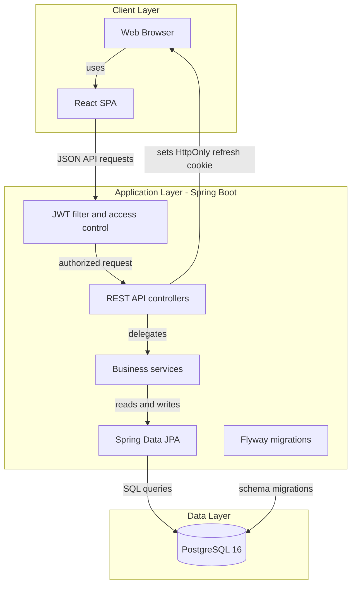
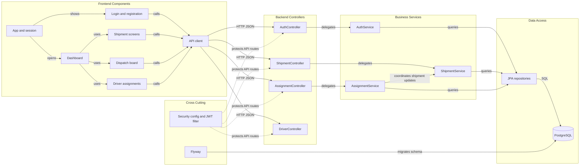

# Architecture Diagram

Waybill is a shipment management and delivery dispatch application with a React client, a Spring Boot REST API, and PostgreSQL persistence.

## Application Architecture

<!-- mermaid-checked: no \n, no em-dash/en-dash, no {} in labels, subgraphs are id["label"], arrows are -->|"label"|, all subgraphs closed by end, ids unique -->

### Technology Stack Summary

| Layer | Technology | Version | Purpose |
| --- | --- | --- | --- |
| Frontend | React, React DOM | `^19.3.1` | Browser user interface |
| Frontend tooling | Vite | `^8.3.6` | Development server and production build |
| Backend | Java | 21 | Backend runtime and language |
| Backend | Spring Boot | 4.1.2 | REST application framework |
| Backend | Spring MVC, Spring Security, Spring Data JPA | Managed by Spring Boot 4.1.2 | HTTP API, access control, and persistence |
| Backend | Flyway | 11.8.2 | Database schema migrations |
| Backend | JJWT | 0.12.6 | JWT token handling |
| Database | PostgreSQL | 16 | Persistent application data |

### Data Storage & External Services

PostgreSQL stores application records, and Flyway applies schema migrations and seed data. No cache, message broker, or third-party API integration is configured. During local development, Vite proxies `/api` requests to the Spring Boot server.

### Key Architectural Decisions

- The REST API is stateless; the frontend keeps access tokens in memory and the backend sets refresh tokens in an `HttpOnly` cookie.
- Controllers, services, and repositories separate API, business, and persistence responsibilities.
- Flyway owns schema evolution while Spring Data JPA accesses PostgreSQL.

## Component Relationships

<!-- mermaid-checked: no \n, no em-dash/en-dash, no {} in labels, subgraphs are id["label"], arrows are -->|"label"|, all subgraphs closed by end, ids unique -->

### Component Inventory

| Component | Layer | Type | Responsibility |
| --- | --- | --- | --- |
| `App` | Presentation | React root component | Restores the session and selects the screen |
| `LoginScreen` | Presentation | React component | Login and driver registration |
| `Dashboard` | Presentation | React component | Role-aware navigation and shipment workspace |
| Shipment components | Presentation | React components | Display, create, edit, and update shipments |
| `DispatchBoard` | Presentation | React component | Assign, reassign, revoke drivers, and view history |
| `DriverAssignments` | Presentation | React component | Review and respond to driver assignments |
| API client | Presentation | JavaScript service module | Sends API requests and refreshes access tokens |
| `AuthController` | API | REST controller | Registration, login, refresh, and logout |
| `ShipmentController` | API | REST controller | Shipment CRUD and status transitions |
| `AssignmentController` | API | REST controller | Dispatch and driver assignment responses |
| `DriverController` | API | REST controller | Lists drivers for administrators |
| `AuthService` | Business logic | Service | User registration and token lifecycle |
| `ShipmentService` | Business logic | Service | Shipment rules and status transitions |
| `AssignmentService` | Business logic | Service | Assignment lifecycle and expiry |
| JPA repositories | Data access | Repositories | Reads and writes persistent entities |
| Security configuration and JWT filter | Infrastructure | Security | Authenticates requests and enforces roles |
| Flyway | Infrastructure | Migration tool | Applies database migrations |
